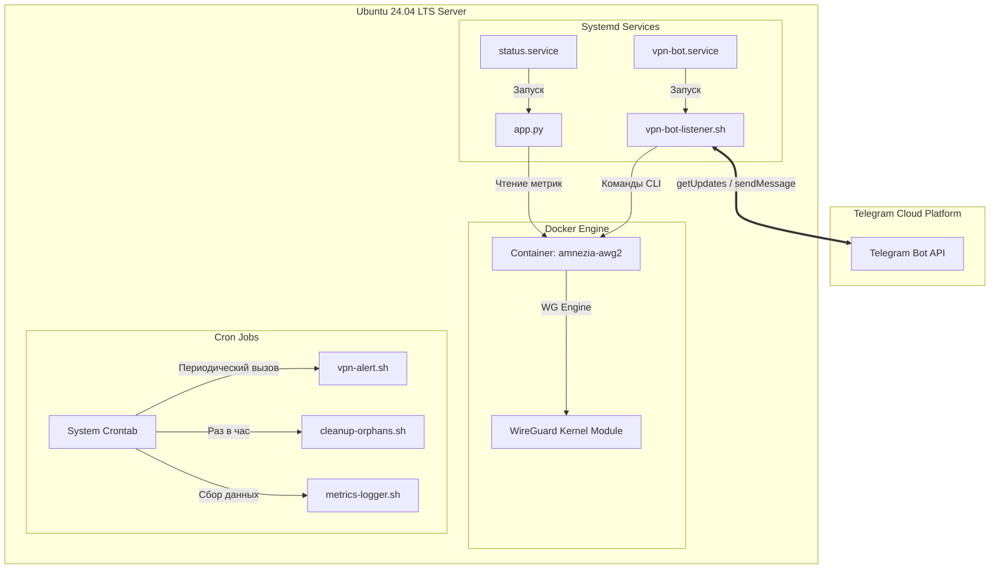
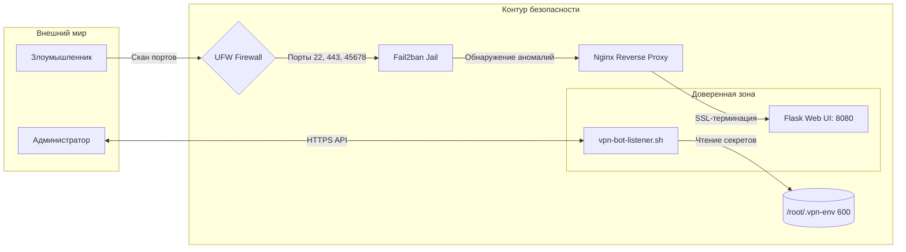

# 🛡️ AmneziaWG Secure Infrastructure & Management Bot

# 🛡️ AmneziaWG Secure Infrastructure & Management Bot


Профессиональная инфраструктура для развёртывания, автоматического мониторинга и администрирования защищённого VPN-сервера AmneziaWG на базе ОС **Ubuntu 24.04 LTS**. Проект включает в себя Telegram-бота для интерактивного контроля и веб-панель статуса с аутентификацией.

# 🛡️ AmneziaWG Secure Infrastructure & Management Bot

## 🌟 Основные возможности

- **VPN AmneziaWG в Docker**: Контейнеризированный сервер с автоматической установкой и сетевым тюнингом (BBR) для стабильного пинга под нагрузкой.
- **Интерактивный Telegram-бот**: Полный мониторинг, вывод топа потребителей, перезапуск с системой двухэтапного подтверждения. Использует надежный Python-парсинг JSON.
- **Безопасная панель Flask**: Доступна на порту `45678` с SSL-сертификатом и паролем администратора.
- **Эшелонированная оборона**: UFW (запрет по умолчанию), Fail2ban с алертами в Telegram, изоляция процессов через systemd (`ProtectSystem=full`).
- **Автоматизация Cron**: Мониторинг ресурсов, резервное копирование, очистка мусора и автоматические ночные перезагрузки.

## 🛠️ Развёртывание

Запустите установщик на чистой ОС Ubuntu 24.04 LTS от пользователя `root`:

```bash
chmod +x install.sh
./install.sh
```

В процессе установки скрипт запросит в защищённом режиме (без вывода на экран):

- Токен вашего Telegram-бота (`BOT_TOKEN`).
- ID чата администратора (`CHAT_ID`).
- Пароль для входа в панель Flask (`FLASK_ADMIN_PASSWORD`).

Режим проверки здоровья (Health Check):

```bash
./install.sh --check
```

## 🛡️ Безопасность и Харденинг

- **Защита переменных**: Конфигурационный файл `/root/.vpn-env` закрыт маской `600`.
- **Systemd Isolation**: Сервисы бота работают с флагами `NoNewPrivileges=true` и `ProtectSystem=full`.
- **Сетевая безопасность**: UFW открывает только порты `22`, `443` и `45678`. Fail2ban мониторит логи и банит подозрительную активность.

## 🏗️ Архитектурные схемы

### 1. Операционная архитектура



### 2. Архитектура безопасности



## 🛠️ Шпаргалка админа

```bash
# Проверка здоровья системы
./install.sh --check

# Статус сервисов
systemctl status vpn-bot.service
docker ps --filter name=amnezia-awg2

# Безопасность: просмотр забаненных IP
sudo fail2ban-client status vpn-monitoring
sudo fail2ban-client set vpn-monitoring unbanip <IP>

# Обслуживание
/root/scripts/backup-docker.sh      # Ручной бэкап
/root/scripts/cleanup-orphans.sh    # Очистка дискового пространства
```
