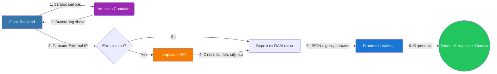
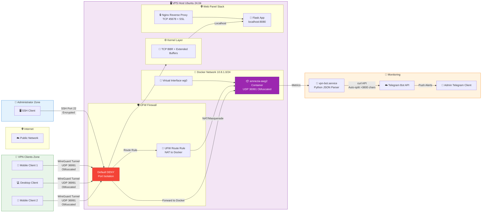
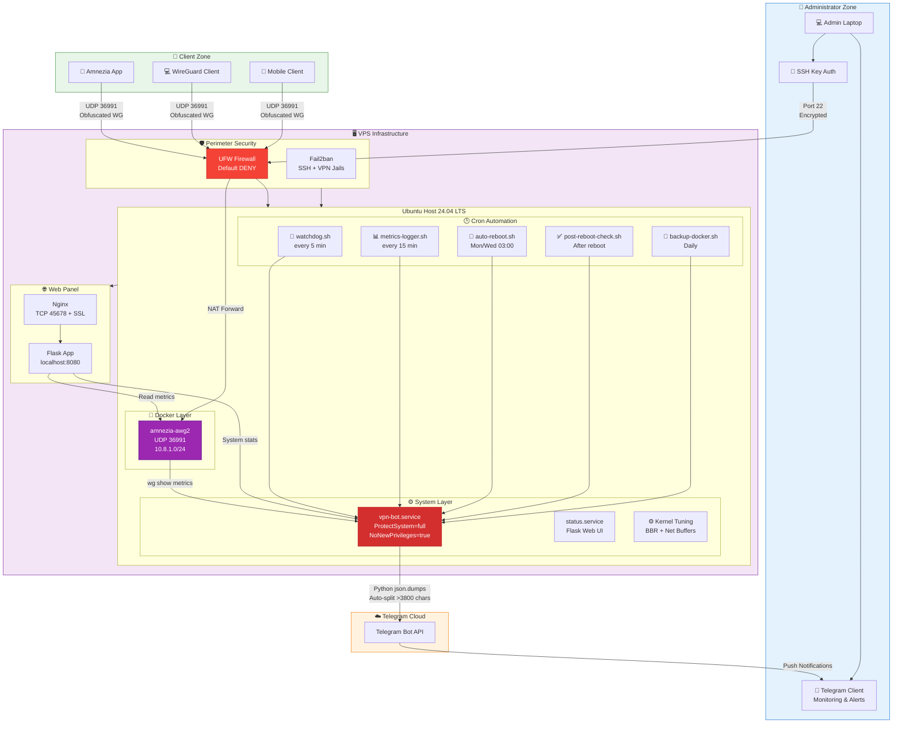
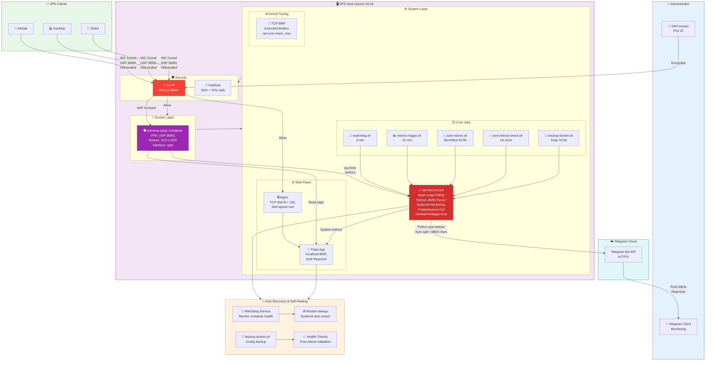

# 🛡️ AmneziaWG Secure Infrastructure & Management Bot


Профессиональная инфраструктура для развёртывания, автоматического мониторинга и администрирования защищённого VPN-сервера AmneziaWG на базе ОС **Ubuntu 24.04 LTS**. Проект включает в себя Telegram-бота для интерактивного контроля и веб-панель статуса с аутентификацией.

## 🌟 Основные возможности

- **VPN AmneziaWG в Docker**: Контейнеризированный сервер с автоматической установкой и сетевым тюнингом (BBR) для стабильного пинга под нагрузкой.
- **Интерактивный Telegram-бот**: Полный мониторинг, вывод топа потребителей, перезапуск с системой двухэтапного подтверждения. Использует надежный Python-парсинг JSON.
- **Безопасная панель Flask**: Доступна на порту `45678` с SSL-сертификатом и паролем администратора.

- **Интерактивная GeoMap (`/map`)**: Визуализация подключений в реальном времени на темной карте Leaflet.js. Включает зеленые пульсирующие маркеры, боковую панель со списком клиентов (с плавной навигацией по клику), подсчет уникальных городов и суммарного трафика.
- **Расширенная таблица клиентов**: На главном дашборде добавлен живой поиск, сортировка по столбцам и модальные окна с детальной информацией (дата создания, полный публичный ключ с кнопкой копирования, точный объем трафика).

### 🌍 Принцип работы Geo-локации (GeoMap)
Система определяет местоположение клиентов без установки ПО на их устройства, используя следующий безопасный конвейер:


* **Кэширование:** Чтобы не превысить лимиты бесплатного API (45 запросов/мин), полученные координаты хранятся в оперативной памяти сервера в течение 24 часов.
* **Точность:** Определяется по регистрации IP-блока провайдера в глобальных реестрах (RIPE). Для мобильных операторов и крупных провайдеров это обычно уровень города или района узла связи.
- **Интерактивная GeoMap (`/map`)**: Визуализация подключений в реальном времени на темной карте Leaflet.js. Включает зеленые пульсирующие маркеры, боковую панель со списком клиентов (с плавной навигацией по клику), подсчет уникальных городов и суммарного трафика.
- **Расширенная таблица клиентов**: На главном дашборде добавлен живой поиск, сортировка по столбцам и модальные окна с детальной информацией (дата создания, полный публичный ключ с кнопкой копирования, точный объем трафика).
- **Эшелонированная оборона**: UFW (запрет по умолчанию), Fail2ban с алертами в Telegram, изоляция процессов через systemd (`ProtectSystem=full`).
- **Автоматизация Cron**: Мониторинг ресурсов, резервное копирование, очистка мусора и автоматические ночные перезагрузки.

## 🛠️ Развёртывание

Запустите установщик на чистой ОС Ubuntu 24.04 LTS от пользователя `root`:

```bash
chmod +x install.sh
./install.sh
```

В процессе установки скрипт запросит в защищённом режиме (без вывода на экран):

- Токен вашего Telegram-бота (`BOT_TOKEN`).
- ID чата администратора (`CHAT_ID`).
- Пароль для входа в панель Flask (`FLASK_ADMIN_PASSWORD`).

Режим проверки здоровья (Health Check):

```bash
./install.sh --check
```

## 🌐 Порты и сетевые правила

| Порт | Протокол | Назначение | UFW-правило |
|------|----------|------------|-------------|
| `22` | TCP | SSH-доступ администратора | `ALLOW IN` |
| `45678` | TCP | Веб-панель (Nginx + Flask, SSL) | `ALLOW IN` |
| `36991` | UDP | AmneziaWG (VPN-клиенты) | `ALLOW FWD` -> Docker |

Внутренние (только localhost, UFW не пропускает):
- `8080/tcp` - Flask (gunicorn) за Nginx
- `53/tcp`   - systemd-resolved (stub resolver)

Проверка активных правил:

    ufw status numbered
    docker port amnezia-awg2
    ss -tulnp | grep LISTEN

## 🛡️ Безопасность и Харденинг

- **Защита переменных**: Конфигурационный файл `/root/.vpn-env` закрыт маской `600` (только root).
- **Systemd Isolation**: Сервисы бота работают в песочнице с флагами `NoNewPrivileges=true`, `ProtectSystem=full` и `PrivateTmp=true`.
- **Сетевая безопасность**: UFW открывает только порты `22/tcp` (SSH), `45678/tcp` (веб-панель) и `36991/udp` (AmneziaWG, `ALLOW FWD` -> Docker). Fail2ban мониторит логи и банит подозрительную активность с алертами в Telegram.
- **Синхронизация времени (NTP)**: `systemd-timesyncd` принудительно активен. Это критически важно для предотвращения replay-атак в WireGuard/AmneziaWG.
- **Защита от переполнения диска**: Docker настроен на автоматическую ротацию логов (макс. 3 файла по 10 МБ), что исключает отказ системы из-за нехватки места.
- **Fail2ban с recidive-jail**: помимо базовых jail'ов (`sshd`, `vpn-monitoring`) работает `recidive` — рецидивисты получают бан на **7 дней** при 3+ повторных попытках за 24 часа. Читает `/var/log/fail2ban.log` через `backend = polling`, блокирует на уровне iptables (цепочка `f2b-recidive` в `INPUT`).
- **Автообновления безопасности**: `unattended-upgrades` устанавливает security-патчи Ubuntu ежедневно (обычно в 06:00). В связке с плановым ребутом (Пн/Ср 03:00) это гарантирует применение свежего ядра без ручного вмешательства.
- **Hardening Nginx**: Веб-сервер скрыл свою версию (`server_tokens off`) и ограничил максимальный размер запроса (`1M`) для защиты от DoS-атак на панель.

## 🏗️ Архитектурные схемы

### 1. Операционная архитектура



### 2. Полная инфраструктура VPS



### 3. Модель безопасности (Defense in Depth)

```mermaid
flowchart LR
    subgraph External["⚠️ External"]
        direction TB
        Attacker["👤 Attacker"]
        Internet["☁️ Internet"]
    end

    subgraph L1["1️⃣ Perimeter"]
        direction TB
        UFW["🔥 UFW<br/>DENY ALL<br/>22, 45678, 36991"]
        Fail2ban["🚫 Fail2ban<br/>sshd, vpn-monitoring<br/>recidive (7d)"]
    end

    subgraph L2["2️⃣ Access Control"]
        direction TB
        SSHKey["🔑 SSH Key-Only<br/>PasswordAuth no"]
        PortIso["🚧 Port Isolation<br/>22/45678/36991"]
        F2BBrute["🛑 Brute-Force<br/>MaxRetry 3-5"]
    end

    subgraph L3["3️⃣ System Isolation"]
        direction TB
        SysdSandbox["⚙️ systemd Sandbox<br/>ProtectSystem=full<br/>NoNewPrivileges=true<br/>PrivateTmp=true"]
        DockIso["🐳 Docker Isolation<br/>amnezia-awg2<br/>10.8.1.0/24"]
    end

    subgraph L4["4️⃣ Data Protection"]
        direction TB
        Secrets["🔑 /root/.vpn-env<br/>chmod 600<br/>root:root"]
        NoPeer["❌ No Persistent<br/>Peer Data<br/>Only runtime metrics"]
        Tunnel["🔐 Encrypted<br/>WireGuard Tunnel<br/>UDP 36991"]
    end

    subgraph L5["5️⃣ Monitoring"]
        direction TB
        BotSec["🤖 Secure Bot<br/>JSON sanitize"]
        TGAPI["☁️ Telegram API<br/>HTTPS + ENV token"]
        Alerts["📱 Admin Alerts<br/>Real-time"]
    end

    Attacker -->|"Scan / Brute"| UFW
    Internet -->|"Legit"| UFW
    UFW --> Fail2ban
    Fail2ban --> SSHKey
    SSHKey --> PortIso
    PortIso --> F2BBrute
    F2BBrute --> SysdSandbox
    SysdSandbox --> DockIso
    DockIso --> Secrets
    Secrets --> NoPeer
    NoPeer --> Tunnel
    Tunnel --> BotSec
    BotSec --> TGAPI
    TGAPI --> Alerts

    style External fill:#ffebee,stroke:#c62828,stroke-width:2px
    style L1 fill:#ffebee,stroke:#c62828,stroke-width:2px
    style L2 fill:#e3f2fd,stroke:#1565c0,stroke-width:2px
    style L3 fill:#f3e5f5,stroke:#6a1b9a,stroke-width:2px
    style L4 fill:#e8f5e9,stroke:#2e7d32,stroke-width:2px
    style L5 fill:#fff3e0,stroke:#ef6c00,stroke-width:2px
    style UFW fill:#f44336,stroke:#b71c1c,color:#fff
    style Secrets fill:#43a047,stroke:#1b5e20,color:#fff
```



### 4. Auto-Recovery & Self-Healing



## 🤖 Команды Telegram-бота

Все команды доступны **только администратору** (проверка `CHAT_ID` из `/root/.vpn-env`).

### 📊 Мониторинг
- `/status` — статус VPN (клиенты, трафик, контейнер, ресурсы)
- `/stat` — алиас `/status`
- `/server_status` — CPU, RAM, диск, аптайм хоста
- `/top` — топ-10 клиентов по трафику
- `/health` — health-check системы

### 👥 Клиенты
- `/users` — краткий список (IP + имя)
- `/clients` — детальный список (статус, Rx/Tx, last handshake)
- `/userstatus <N>` — статус клиента по последнему октету IP

### 🔧 Управление (с двухэтапным подтверждением)
- `/restart_container` — перезапуск VPN-контейнера
- `/reboot_server` — перезагрузка сервера

### 🛠 Обслуживание
- `/cleanup` — очистка (`cleanup-server.sh`), показывает использование диска до/после

### ℹ️ Информация
- `/start` — приветствие
- `/help` — список команд
- `/ping` — проверка отклика бота
- `/logs` — последние записи лога

## 🛠️ Шпаргалка админа

```bash
# === МОНИТОРИНГ И СТАТУС ===
# Проверка здоровья всей системы
./install.sh --check

# Статус сервисов
systemctl status vpn-bot.service
docker ps --filter name=amnezia-awg2

# === БЕЗОПАСНОСТЬ ===
# Просмотр забаненных IP
sudo fail2ban-client status vpn-monitoring
sudo fail2ban-client set vpn-monitoring unbanip <IP_АДРЕС>

# Проверка синхронизации времени (должно быть synchronized: yes)
timedatectl status | grep synchronized

# Проверка лимитов логов Docker
cat /etc/docker/daemon.json

# === ОБСЛУЖИВАНИЕ ===
# Ручной бэкап конфигураций
/root/scripts/backup-docker.sh

# Очистка дискового пространства и старых образов
/root/scripts/cleanup-orphans.sh

# Аудит скриптов на ошибки
shellcheck /root/scripts/*.sh /opt/vpn-amnezia-infrastructure/install.sh

# === RECIDIVE (долгие баны) ===
# Статус: кого поймал
sudo fail2ban-client status recidive
# Реальные правила блокировки в ядре
sudo iptables -L f2b-recidive -n -v
# Разбанить вручную (если IP ложный)
sudo fail2ban-client set recidive unbanip <IP>

# === АВТООБНОВЛЕНИЯ БЕЗОПАСНОСТИ ===
# Лог: что установилось
sudo tail -20 /var/log/unattended-upgrades/unattended-upgrades.log
# Dry-run: что БУДЕТ установлено в след. раз
sudo unattended-upgrade --dry-run
```
